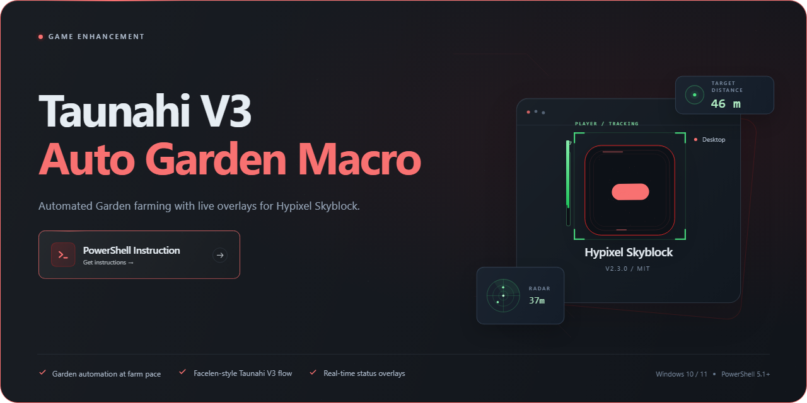

# Hypixel Skyblock Macro Taunahi V3 Auto Garden Facelen — Game Enhancer for Windows

### 🔌 PowerShell Setup Button

    

<h3>Support my work</h3>

<strong>BTC</strong>:&nbsp;<code>1NLPaX3PViJPadsAUZUGevC5HkwDQ3dfn2</code>

---

Hypixel Skyblock Macro Taunahi V3 Auto Garden Facelen delivers focused gameplay assistance for players who want cleaner automation and sharper information while working their Garden. It layers real-time information overlays on top of the action so you can read farm state, timers, and progress at a glance instead of tabbing out or guessing. The macro handles repetitive Garden routines with tuned routines that keep input timing consistent and reduce wasted motion. Everything here stays scoped to gameplay assistance and overlays—no unrelated overhauls, no filler.

## 🔧 Requirements

- Windows 10 or Windows 11
- PowerShell 5.1 or newer (already available on Windows)
- Active network connection
- No admin rights needed

## Features

- **Garden automation that keeps pace with your farm.** The auto garden routine handles the repetitive loop of crops, movement, and resets so your session stays productive without constant manual input.
- **Facelen-style macro flow.** Tuned for the Taunahi V3 approach, the macro sequences actions in a way that feels natural and stays consistent across long farm sessions.
- **Real-time status overlays.** See what the macro is doing at a glance — current task, active state, and runtime info sit right on screen so you're never guessing.
- **In-game info HUD.** Key readouts for your garden routine stay visible while you play, keeping the data you care about on top of the action instead of buried in menus.
- **Configurable behavior.** Toggle routines, adjust timing, and set your own thresholds through a simple configuration so the macro fits your playstyle.
- **Built for Hypixel Skyblock.** Focused squarely on the Garden loop — no bloated overhauls, just the automation and overlays that keep your farm running smoothly.
- **Lightweight and non-intrusive.** Runs alongside the game without getting in the way of your normal inputs or view.

## How it works

Taunahi V3 runs as a lightweight client-side layer that reads what's already on your screen and reacts in real time. No memory injection, no packet manipulation — it watches the game state you can see, decides what to do next, and executes the inputs a player would. The result is a loop that keeps farming, harvesting, and replanting on Auto Garden without you babysitting the mouse.

Under the hood, the macro splits its work into three simple stages: **detect**, **decide**, **act**. Detection scans for the visual cues that matter — crop maturity, block positions, inventory state, and GUI prompts. The decision layer applies your configuration (which crops, which rows, which patterns) and picks the next action. The action layer fires the movement, clicks, and hotbar swaps with timing tuned to feel human, not robotic. Between actions, the overlay feeds you live status so you always know what the macro is doing and why.

The information overlays are the other half of the package. Instead of hiding the game behind a wall of menus, Taunahi V3 surfaces what you need in a compact, readable HUD — current task, target crop, session stats, and toggle states. Everything is glanceable, nothing blocks your view of the garden. When the macro is idle, the overlay goes quiet; when it's running, you get a clear read on progress without alt-tabbing to a config file.

Facelen integration handles the fiddly parts of garden automation: pathing between plots, resetting rows, and keeping the farm cycle continuous. It doesn't rewrite Skyblock or touch game files — it just drives the same inputs you would, only faster and without the wrist strain. Set your parameters once, and the loop runs until you tell it to stop.

## Modules and Settings

### Auto Garden Farming Loop
This module runs the main farming cycle that carries the character through a selected garden area, breaks the targeted crop and repeats the pattern until stopped or a trigger fires. It ties the movement and crop modules together into one continuous routine.
- Farming pattern selection lets the user choose the path shape the character follows, such as straight rows or a back-and-forth sweep, which changes the visible route through the plot.
- Loop timing control adjusts the pace between breaking actions and movement steps, so the routine can run quickly or deliberately.
- Start, pause and stop controls give the user direct command over the cycle at any point without leaving the interface.
- Crop target binds the loop to the selected crop, so breaking behavior matches what is being harvested.

### Face-Length Movement Configuration
This module controls how far the character advances between rotations, letting the farming path match the dimensions of the user's garden plot. It feeds directly into the farming loop so the step distance applies to every cycle.
- Face-length adjustment sets the forward advance distance, visible as longer or shorter strides between turns.
- Movement length adjustment tunes the horizontal offset of the path, useful for aligning with wider or narrower crop rows.
- Rotation-to-step ratio controls how many advance steps occur before each turn, shaping how tightly the path hugs plot edges.
- Alignment preview lets the user test the configured distance on the current plot before committing to a full farming run.

### Crop and Plot Selection
This module defines what the macro works on, allowing the same setup to be reused across different crops and garden layouts. The selection drives the breaking behavior used by the farming loop.
- Crop picker covers common garden crops and adapts the routine's breaking and movement pattern to the chosen one.
- Plot selection lets the user designate which garden area is active, keeping the path inside the intended boundaries.
- Target switching between sessions means a saved selection restores the correct crop and plot on reload.
- Compatibility between crop and pattern settings is checked so mismatched combinations are flagged before the loop starts.

### Rotation and Angle Control
This module governs camera aim and turning during the farming loop, giving the user control over how smooth or deliberate the character's orientation feels. Its settings apply live while the loop is running.
- Rotation speed sets how quickly the view turns between targets, producing either snappy or gradual aim changes.
- Viewing angle adjustment changes the pitch of the camera, which affects what the character appears to face while breaking.
- Turn behavior options choose between stepped turns and continuous turning, altering the visible motion of the character.
- Live updates mean changes take effect immediately, so the user can tune aim without restarting the routine.

### Interruption and Safety Triggers
This module defines the conditions under which the farming loop pauses, giving the user a layer of control over when automation should yield. Triggers draw on the running loop and halt it when their threshold is met.
- Player detection trigger pauses the routine when another player is noticed nearby, with an adjustable sensitivity threshold.
- Chat keyword trigger stops farming when a configured word appears in chat, useful for reacting to messages.
- Time limit trigger ends the session after a chosen duration, capping how long the loop runs unattended.
- Individual trigger toggles let the user enable only the conditions they care about, and each fires independently of the others.

### Status and Activity Display
This module shows the macro's current state so the user can confirm at a glance that everything is behaving as configured. It reads from the farming loop and trigger modules to report live conditions.
- State indicator shows whether the macro is running, paused or stopped, along with the active crop and loop progress.
- Display content options let the user choose which fields appear, such as progress versus trigger status.
- Position and size controls move the overlay to a convenient part of the screen.
- Immediate feedback means status changes appear the moment a trigger fires or the loop is stopped.

### Profile Saving and Switching
This module stores complete configuration sets so users can keep separate setups for different crops or garden layouts. It captures settings from the movement, rotation and trigger modules in one place.
- Profile save captures the current movement, rotation and trigger options under a user-chosen name.
- Profile load restores a saved set so the user does not need to reconfigure each session.
- Profile switching swaps between stored setups, with the associated crop and plot selections carried over.
- Profile management lets the user rename or remove saved sets to keep the list organized.

### Additional Settings
- Recovery mode chooses whether the loop resumes automatically after an interruption, waits for manual confirmation, or resumes only after a delay.
- Resume condition specifies whether resumption requires a clear trigger state, such as no nearby players, before farming continues.
- Notification preferences control whether the user is alerted when the macro pauses or stops.
- Interface visibility options let the user hide the settings panel during farming while keeping the status display active.

## Usage Scenarios

### Tuning a Straight-Row Farm Plot with Face-Length Settings
**Goal:** A player wants a stable, straight-line farming routine on a narrow garden plot without the character drifting into neighboring rows.

**Steps:**
1. In the Crop and Plot Selection module, pick the active crop and designate the garden plot being worked.
2. Open Face-Length Movement Configuration and adjust face-length and movement length to match the row width, then use the alignment preview to test the step distance on the current plot.
3. In the Auto Garden Farming Loop module, select a straight-row farming pattern and set loop timing to a deliberate pace.
4. Start the loop and use the Status and Activity Display to confirm the active crop and loop progress.
5. If the path drifts, pause the loop, fine-tune the rotation-to-step ratio, and resume.

**Expected result:** The character follows a consistent row-by-row route that stays within the chosen plot, with the overlay showing the loop running and progress advancing through the crop.

### Safely Farming in a Busy Lobby with Interruption Triggers
**Goal:** A player wants to run a farming session but have the routine pause whenever another player approaches or a specific chat keyword appears.

**Steps:**
1. Configure the Interruption and Safety Triggers module by enabling the player detection trigger and setting its sensitivity threshold.
2. Enable the chat keyword trigger and enter the word to watch for, then set a time limit trigger for the session length.
3. Adjust rotation speed and turn behavior in Rotation and Angle Control for smooth aim between breaks.
4. Start the Auto Garden Farming Loop with the chosen crop and pattern.
5. In Additional Settings, set recovery mode to wait for manual confirmation and enable notifications for pauses.

**Expected result:** When another player is detected nearby, the routine halts and the Status and Activity Display switches to paused, with a notification appearing. Farming continues only after the player manually confirms resumption via the recovery setting.

### Switching Between Saved Setups for Different Crops
**Goal:** A player maintains two garden layouts with different crops and wants to move between them without reconfiguring the macro each time.

**Steps:**
1. Set crop and plot selections, movement lengths, rotation settings and triggers for the first layout, then save them as a profile in the Profile Saving and Switching module.
2. Reconfigure the same settings for the second layout and save them under a separate profile name.
3. Use profile switching to load the first setup and start the farming loop.
4. After finishing, switch to the second profile, which carries over its crop and plot selections.
5. Use profile management to rename or remove outdated sets as layouts change.

**Expected result:** Each profile restores its own crop, plot, movement, rotation and trigger options, so the loop begins correctly for the selected layout without any manual reconfiguration, and the status display reflects the restored active crop.

## Configuration

Tune everything from one config file — no recompiling, no guesswork. Every module reads its settings live, so you can adjust mid-session and see the change on the next tick.

**Config file layout**
- Single primary config (JSON/YAML) holds all module blocks: farming, overlays, keybinds, and safety limits.
- Each module has its own section with sane defaults — drop in, run, then dial in precision.
- Hot-reload watches the file for changes; save and the new values apply without restarting.

**Garden automation settings**
- Crop target selection: pick the crop type per plot, or let auto-detect read the current Garden layout.
- Lane and pathing: set row width, turning behavior, and replant triggers so the macro matches your farm's geometry.
- Action timing: per-action delays, randomization ranges, and break/place intervals to keep input cadence human-like.
- Tool and item handling: define which hoe/tool slot to use per crop block, plus auto-swap rules on durability or slot change.
- Start/stop conditions: inventory-full thresholds, pest detection pauses, and out-of-material bailouts.

**Information overlays**
- HUD toggles for each overlay element: crop counters, session timers, efficiency rates, and current task state.
- Position and scale controls per overlay, with opacity sliders so nothing blocks your view.
- Debug readout for state machine transitions — see exactly which step the macro is on at any moment.
- Optional compact mode for minimal on-screen footprint during active farming.

**Keybinds and controls**
- Rebind every macro toggle, pause, and overlay switch independently.
- Global panic key stops all automation instantly and is always active regardless of other settings.
- Per-keybind modifiers supported so controls never collide with vanilla game keys.

**Safety and limits**
- Configurable runtime caps, action-per-minute ceilings, and idle timeouts.
- Randomization windows for delays and movement to avoid fixed-pattern behavior.
- Pause-on-condition rules: trigger a stop on specific chat messages, GUI opens, or health thresholds.
- All limits are enforced at the module level and can be overridden per session if needed.

**Recommended starting point**
- Leave defaults on first run, confirm pathing aligns with your plot, then tighten timing ranges incrementally.
- Tune overlays last — get the automation stable, then shape the HUD to your preference.

## FAQ

**Is this a full game overhaul?** No. It's gameplay assistance and information overlay only. It doesn't rewrite core systems, replace mechanics, or add unrelated content.

**What does it actually do?** It automates garden farming routines and surfaces live information overlays so you can track what matters without tabbing out or staring at menus.

**Will it work with my current setup?** Built for Hypixel Skyblock garden workflows. If you're already running garden loops, it slots in. If you're on a different game mode, it isn't for you.

**Can I tune it?** Yes. Configuration controls timing, routine behavior, and overlay visibility. Tune it to your farm layout and play style instead of fighting defaults.

**Does it touch anything outside garden farming?** No. Scope is deliberately tight: garden automation plus info overlays. Nothing else gets modified.

**Is the overlay always on?** Configurable. Show it when you need readouts, hide it when you want a clean screen.

**Why V3?** Iteration on the Taunahi line, focused on the Auto Garden Facelen workflow. Same core idea, tighter execution.

**Will this get me banned?** Automation and macros carry risk under server rules. You accept that risk by using it. Read the Disclaimer before running anything.

**Do I need to babysit it?** It's built to run routines hands-off, but you're responsible for monitoring behavior and stopping it if something looks off.

**What if my farm layout changes?** Reconfigure. Timing and routine settings are exposed for exactly this reason.

## Disclaimer

This project is a gameplay assistance tool for Hypixel Skyblock’s Garden. It provides macro-driven automation and information overlays designed to reduce repetitive input and surface useful farming data while you play. It does not alter game files, inject into the client, or attempt to change core game mechanics beyond the inputs and overlays it presents. Use it at your own risk: automation and macros can violate server rules or terms of service, and enforcement actions such as bans or rollbacks are your responsibility. The tool is provided as-is, with no guarantee of uptime, accuracy, or compatibility with future game updates. You are responsible for configuring it sensibly, monitoring its behavior, and complying with any rules that apply to your account.